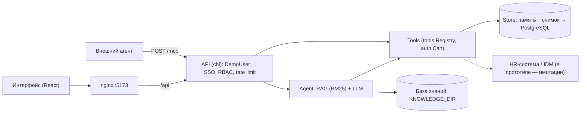

# AI-buddy — ИИ-наставник для стажёров (Hack&Change 2026, кейс Авито)

Прототип помощника для стажёра Backend-команды Авито:

- отвечает на рабочие вопросы по базе знаний **со ссылкой на источник**, а если ответа нет — честно отправляет к наставнику;
- ведёт по чек-листу адаптации;
- **готовит действия** в корпоративных сервисах (имитации): заявку на отгул и запрос доступа. Действие создаётся только после подтверждения стажёра, а отгул согласует руководитель;
- даёт наставнику и руководителю кабинет: прогресс стажёров, входящие заявки и список вопросов, на которые в базе знаний нет ответа;
- отдаёт те же инструменты внешним агентам по **MCP** (`POST /mcp`).

Состав: бэкенд на Go (корень репозитория) и интерфейс на React (`frontend/`).

## Запуск с нуля

### Docker (рекомендуется) — весь проект одной командой
```bash
cp .env.example .env
docker compose up --build
```
- **Интерфейс: http://localhost:5173**
- API: http://localhost:8080 (`curl -s localhost:8080/health` → `{"status":"ok"}`)

Состояние хранится в томе `buddy-state` и переживает перезапуск. Сброс к начальным данным: `docker compose down -v`.

### Локально (Go 1.22+, Node 22)
```bash
cp .env.example .env
go run ./cmd/server                    # бэкенд на :8080 (или: make run)

cd frontend && npm install && npm run dev   # интерфейс на http://localhost:5173, /api проксируется на :8080
```

## Проверка в интерфейсе (2 минуты)

Откройте http://localhost:5173. Пользователь переключается в шапке («Тестовый пользователь»).

1. **Стажёр Backend.** Нажмите подсказку «Хочу взять отгул в пятницу» → появится черновик с датой → «Отправить заявку». Справа в «Моих заявках» — статус «ждёт согласования».
2. Напишите «Запроси доступ в GitLab» → «Отправить заявку». Шаг «Получить доступы» в чек-листе получает пометку «ждёт согласования» (номер заявки — во всплывающей подсказке); кнопки «готово» у него нет — шаг закроется сам после согласования.
3. Спросите «Как у нас устроено код-ревью?» — ответ с источником. Спросите «Сколько платят в Авито?» — честный отказ с именем наставника.
4. **Руководитель Backend.** Справа кабинет команды: обе заявки стажёра, прогресс стажёров и вопрос без ответа («Чего нет в базе знаний»). Впишите комментарий и нажмите «Согласовать» у заявки на доступ.
5. **Снова Стажёр Backend.** Шаг «Получить доступы» выполнен, прогресс вырос с 25% до 50%, в «Моих заявках» — «согласована» и комментарий руководителя.
6. **Стажёр другой команды** видит только свой чек-лист; на вопрос про логи backend получает отказ (чужая база знаний не видна). **Наставник Backend** видит кабинет команды без кнопок согласования.

Те же сценарии без интерфейса — в разделе «Проверка сценариев (bash)» ниже.

По умолчанию работает **mock-LLM**: ключ и интернет не нужны, ответы детерминированы. Реальная OpenAI-совместимая модель включается так: `LLM_MOCK=false` и `LLM_API_KEY=...` в `.env`. Если реальная модель недоступна, сервис не падает: отвечает резервная модель, ответ помечается `"degraded": true`.

## Переменные окружения

| Переменная | Назначение | По умолчанию |
|---|---|---|
| `ADDR` | адрес сервера | `:8080` |
| `LLM_MOCK` | `true` — mock-LLM; без `LLM_API_KEY` всегда mock | `true` |
| `LLM_BASE_URL` | адрес OpenAI-совместимого API | `https://api.openai.com/v1` |
| `LLM_MODEL` | модель | `gpt-4o-mini` |
| `LLM_API_KEY` | ключ (не коммитить) | — |
| `LLM_FALLBACK` | `false` — не переключаться на резервную модель при сбое | `true` |
| `KNOWLEDGE_DIR` | папка базы знаний | `data/knowledge` |
| `STATE_FILE` | файл снимка состояния; пусто — только в памяти | пусто (в Docker `/app/state/state.json`) |
| `RATE_LIMIT_PER_MIN` | вопросов в минуту на пользователя; `0` — без лимита | `60` |
| `CORS_ORIGINS` | origin фронта через запятую | `localhost:5173`, `127.0.0.1:5173`, `localhost:3000` |

## Тестовые учётные записи

Авторизация в Авито уже есть, поэтому в прототипе она имитируется заголовком `X-Demo-User` (или `?user=` для SSE). Без заголовка — `intern.backend`, неизвестный логин — `401`.

| Логин | Роль | Команда | Что проверить |
|---|---|---|---|
| `intern.backend` | intern | backend | S1, S2, S3 |
| `intern.junior` | intern | backend | второй стажёр команды (виден наставнику) |
| `intern.other` | intern | frontend | чужая заявка/шаг/диалог → 403; база backend не видна |
| `mentor.backend` | buddy | backend | кабинет наставника; материалы «только для наставников» |
| `lead.backend` | lead | backend | согласование заявок; сам оформить отгул не может |

## Проверка сценариев (bash)

Нужен только `curl`. Дата отгула — в будущем: прошедшую дату помощник не оформит и переспросит.

Блоки ниже рассчитаны на `bash`. **На macOS сначала выполните `bash`** (или `setopt interactivecomments` в zsh): в интерактивном zsh по умолчанию `#` не считается комментарием, и пояснения в конце строк уйдут в `curl` как лишние аргументы. В PowerShell используйте вариант в конце раздела.

```bash
H='Content-Type: application/json'
API=localhost:8080
id() { sed 's/.*"action_id":"\([^"]*\)".*/\1/'; }       # достаёт id черновика из ответа

# S1 — отгул: черновик → подтверждение стажёром → согласование руководителем
ABS=$(curl -s $API/api/ask -H "$H" -d '{"question":"Хочу взять отгул 2027-03-15"}' | id); echo $ABS
#   ответ: type=draft, action=absence — заявка ещё НЕ создана
curl -s -X POST $API/api/v1/actions/$ABS/confirm                                  # status=pending
curl -s -X POST $API/api/v1/actions/$ABS/confirm                                  # 409 — повторно нельзя
curl -s -X POST $API/api/v1/actions/$ABS/confirm -H 'X-Demo-User: intern.other'   # 403 — чужая
curl -s -X POST $API/api/v1/actions/$ABS/approve                                  # 403 — стажёр сам себе не согласует
curl -s "$API/api/v1/team/actions?status=pending" -H 'X-Demo-User: lead.backend'  # входящие руководителя
curl -s -X POST $API/api/v1/actions/$ABS/approve -H 'X-Demo-User: lead.backend' -H "$H" -d '{"comment":"Хорошего отдыха"}'
#   status=approved, в history — кто и когда подтвердил и согласовал
curl -s $API/api/v1/actions                                                       # история действий стажёра
curl -s $API/api/ask -H "$H" -d '{"question":"Как оформить отгул?"}'              # правила + имена

# S2 — чек-лист и доступы: заявка двигает шаг чек-листа
curl -s $API/api/ask -H "$H" -d '{"question":"Что мне сделать на этой неделе?"}'  # type=action, next_step
REQ=$(curl -s $API/api/ask -H "$H" -d '{"question":"Запроси доступ в GitLab"}' | id); echo $REQ
curl -s -X POST $API/api/v1/actions/$REQ/confirm
curl -s $API/api/v1/onboarding/progress       # шаг «Получить доступы»: status=waiting, related_action_id=REQ-…
curl -s -X POST $API/api/v1/actions/$REQ/approve -H 'X-Demo-User: lead.backend'
curl -s $API/api/v1/onboarding/progress       # тот же шаг: status=done, percent_done вырос
curl -s -X PATCH $API/api/v1/onboarding/steps/c1-intern-1 -H 'X-Demo-User: intern.other'   # 403 — чужой шаг

# S3 — ответы по базе и отказ
curl -s $API/api/ask -H "$H" -d '{"question":"Как у нас устроено код-ревью?"}'    # type=answer, sources
curl -s $API/api/ask -H "$H" -d '{"question":"Сколько платят в Авито?"}'          # type=refusal, buddy_name

# S4 — кабинет наставника и руководителя
curl -s $API/api/v1/team/progress       -H 'X-Demo-User: mentor.backend'          # прогресс стажёров команды
curl -s $API/api/v1/team/knowledge-gaps -H 'X-Demo-User: mentor.backend'          # «Сколько платят…» — чего нет в базе
curl -s $API/api/v1/team/summary        -H 'X-Demo-User: lead.backend'            # сводка метрик пользы
curl -s $API/api/v1/team/progress                                                 # 403 — стажёру недоступно
```

### Асинхронный чат (как работает UI)
```bash
SID=$(curl -s -X POST $API/api/v1/chat/sessions | sed 's/.*"id":"\([^"]*\)".*/\1/')
curl -sN "$API/api/v1/chat/sessions/$SID/events" &                                # SSE-поток
curl -s $API/api/v1/chat/sessions/$SID/messages -H "$H" -d '{"text":"Хочу взять отгул в пятницу"}'
#   202 сразу; в потоке: status → message_done {result: draft}
```

### MCP (инструменты для внешних агентов)
```bash
curl -s $API/mcp -H "$H" -d '{"jsonrpc":"2.0","id":1,"method":"initialize","params":{}}'
curl -s $API/mcp -H "$H" -d '{"jsonrpc":"2.0","id":2,"method":"tools/list"}'
curl -s $API/mcp -H "$H" -d '{"jsonrpc":"2.0","id":3,"method":"tools/call","params":{"name":"checklist_get","arguments":{}}}'
curl -s $API/mcp -H "$H" -d '{"jsonrpc":"2.0","id":4,"method":"tools/call","params":{"name":"access_request","arguments":{"resource":"grafana"}}}'
#   isDraft=true, action_id=REQ-… — через MCP тоже только черновик
```

### Метрики
```bash
curl -s $API/metrics | grep buddy_
#   buddy_agent_responses_total{type="answer"}, buddy_knowledge_gaps_total, buddy_actions_total{...},
#   buddy_llm_fallback_total, buddy_http_requests_total{route=...}, buddy_sse_streams
```

<details><summary>PowerShell-вариант S1</summary>

```powershell
[Console]::OutputEncoding = [Text.Encoding]::UTF8
function Ask($q) { Invoke-RestMethod http://localhost:8080/api/ask -Method Post -ContentType 'application/json; charset=utf-8' -Body ([Text.Encoding]::UTF8.GetBytes((@{question=$q} | ConvertTo-Json))) }
$d = Ask 'Хочу взять отгул 2027-03-15'; $id = $d.args.action_id
Invoke-RestMethod "http://localhost:8080/api/v1/actions/$id/confirm" -Method Post
Invoke-RestMethod "http://localhost:8080/api/v1/actions/$id/approve" -Method Post -Headers @{ 'X-Demo-User' = 'lead.backend' }
Ask 'Сколько платят в Авито?'
```
</details>

## Тесты и покрытие

```bash
make test      # go test ./...
make cover     # профиль + проверка порога 80%
make html      # coverage/index.html
make race      # go test -race (нужен cgo)
make lint      # gofmt + go vet
```

Покрытие бэкенда: **96,8%** (`coverage/coverage.out`, `coverage/index.html`).

Фронтенд:
```bash
cd frontend
npm test            # 72 теста (vitest)
npm run coverage    # отчёт frontend/coverage/index.html, порог строк 80%; сейчас 100% строк
npm run typecheck
```

CI (`.github/workflows/ci.yml`) на каждый push запускает три задачи: бэкенд (gofmt, vet, `-race`, порог покрытия 80%), фронтенд (typecheck, тесты с покрытием, сборка) и весь проект целиком (`docker compose up` + проверка ответов через UI-прокси).

Что проверяют тесты кроме обычных веток:
- golden-набор из 43 фраз сценариев на реальной базе знаний (`data/golden/golden.json`);
- 100 параллельных диалогов без потерь и перемешивания ответов;
- 30 параллельных подтверждений одной заявки — успешно ровно одно;
- любая «грязь» от LLM (не JSON, галлюцинация без источника, неизвестный инструмент, мусорные даты);
- отказ LLM: повторы, резервная модель, паника клиента, утечка внутренних ошибок;
- перезапуск сервера с сохранением состояния;
- совпадение `specs/contracts/mcp-tools.json` с кодом.

Связь «сценарий/инвариант → тест» — `specs/traceability.md`.

## Архитектура

```
HTTP (chi): RequestID → Recoverer → лог+метрики → CORS → лимит тела → DemoUser (RBAC-контекст) → rate limit
  /api/v1/chat/*        202 + SSE (status → tool_result → message_done), replay, heartbeat, ≤3 ожидающих ответа
  /api/v1/actions/*     черновик → confirm (владелец) → approve | reject (руководитель) | cancel (владелец)
  /api/v1/onboarding/*  чек-лист: todo | waiting | done, прогресс, отметка шага
  /api/v1/team/*        кабинет наставника и руководителя (только своя команда)
  /mcp                  MCP-сервер (JSON-RPC 2.0) поверх того же реестра инструментов
  /metrics, /health
Agent: RAG (BM25 + префиксы, стоп-слова, порог релевантности, фильтр team/audience)
       → LLM (OpenAI-совместимая с повторами → резервная модель | mock) + история диалога
       → answer | tool_call | draft | refusal → инварианты
Tools: checklist_get, absence_get_policy, directory_find_owner (чтение);
       absence_create_request, access_request (только через черновик)
Store: in-memory, потокобезопасный, со снимком на диск (STATE_FILE)
```

```
cmd/server/        точка входа, graceful shutdown, фоновое сохранение состояния
internal/api/      HTTP, чат/SSE, действия, кабинет команды, MCP, middleware, сборка приложения
internal/agent/    оркестратор, промпт, черновики, разбор дат
internal/rag/      чанкинг, поиск, загрузка базы
internal/llm/      OpenAI-совместимый клиент с повторами + mock
internal/tools/    инструменты с проверкой прав и описаниями для MCP
internal/auth/     роли и права (RBAC)
internal/store/    действия с историей, чек-листы, диалоги, пробелы базы, снимок на диск
internal/metrics/  метрики в формате Prometheus без зависимостей
data/knowledge/    синтетическая база знаний
specs/             SDD: agent spec, контракты (openapi, mcp-tools, schema.sql), сценарии, traceability
frontend/          интерфейс: чат, план адаптации, мои заявки, кабинет команды (см. frontend/README.md)
docs/              сценарий демо-видео (DEMO.md), ответы на вопросы (FAQ.md), история (history/)
```

### Гарантии (инварианты из `specs/agent/spec.md`, каждый покрыт тестом)
1. **Нет источника — нет ответа**: текстовый ответ без найденного фрагмента базы превращается в отказ с именем наставника, даже если LLM «знает» ответ.
2. **Нет права — нет действия**: `auth.Can` в каждом инструменте, при подготовке черновика и при подтверждении; владелец проверяется для заявок, шагов и диалогов.
3. **Deny-by-default**: фрагмент без `audience` не виден никому, чужой команды — не виден.
4. **Draft → Confirm → Approve**: даже если LLM вернула вызов мутирующего инструмента (в чате или через MCP), получается только черновик; отгул согласует руководитель своей команды.
5. **LLM не блокирует UI**: 202 за миллисекунды, ответ — по SSE; таймауты run 60 с, инструмент 10 с.
6. **Сбой LLM не останавливает сервис**: повторы → резервная модель → понятная ошибка без внутренних деталей.

## Внешние API и зависимости
- LLM: OpenAI-совместимый `/chat/completions` с `response_format: json_object`.
- Go 1.22, `github.com/go-chi/chi/v5 v5.0.12`, `github.com/go-chi/cors v1.2.2`, `github.com/google/uuid v1.6.0`. Метрики, MCP и хранение — без внешних библиотек.
- Фронтенд: Node 22, React 18.3, TanStack Query 5, Zustand 5, Zod 3, Vite 5, Vitest 2 (точные версии — `frontend/package-lock.json`).

## Ограничения прототипа
- Данные и инструкции синтетические (`data/knowledge/*` помечены «Тестовая инструкция, не регламент Авито»); сервисы отсутствий и доступов — имитации.
- Хранилище — память со снимком в JSON-файл, а не СУБД; рассчитано на один экземпляр сервиса.
- Авторизация — заголовок `X-Demo-User` вместо SSO.
- MCP-сервер встроен в бэкенд (один процесс), транспорт — одиночные JSON-RPC запросы по HTTP без стриминга.
- Нет финансовых операций и чувствительных ПДн.
- Roadmap: PostgreSQL (`specs/contracts/schema.sql`), отдельный agent-сервис (`specs/contracts/agent-api.md`), SSO, эмбеддинги поверх BM25.

## Внедрение в Авито

Прототип собран так, чтобы имитации заменялись адаптерами без переделки агента, API и интерфейса.



### Что заменить

| Имитация в прототипе | Реальная система Авито | Что меняется в коде |
|---|---|---|
| Заголовок `X-Demo-User`, middleware `DemoUser` (`internal/api/middleware.go`), учётки `auth.DemoUsers` | SSO / JWT | Новый middleware кладёт в контекст тот же `auth.User` (id, роль, команда); проверки `auth.Can` и владельца не меняются |
| Отгул: `internal/tools/absence.go`, `absence_policy.go`, подтверждение и согласование в `internal/api/actions.go` | HR-система (отсутствия) | Адаптер за тем же интерфейсом `tools.Tool` в `tools.Registry`; поток «черновик → подтверждение → согласование» сохраняется |
| Доступы: `internal/tools/access.go` | IDM / система заявок на доступ | Адаптер за `tools.Tool`; шаг чек-листа «Получить доступы» закрывается по статусу заявки, как сейчас |
| `data/knowledge/*.md` с разметкой `team` и `audience` | Confluence | Выгрузка по расписанию в `KNOWLEDGE_DIR` с теми же полями `team` и `audience`; без `audience` фрагмент не виден никому |
| Хранилище в памяти со снимком (`internal/store`, `STATE_FILE`) | PostgreSQL | Новая реализация Store по `specs/contracts/schema.sql` (роли, статусы и id совпадают с прототипом) |
| mock-LLM (`LLM_MOCK=true`) | LLM во внутреннем контуре | `LLM_MOCK=false`, `LLM_BASE_URL`, `LLM_MODEL`, `LLM_API_KEY`; резервная модель и `degraded` уже есть |
| MCP внутри бэкенда (`POST /mcp`) | Корпоративные агенты и ассистенты | Подключаются к тому же реестру инструментов с теми же правами, контракт — `specs/contracts/mcp-tools.json` |

### План пилота
1. **Одна команда, 2–4 недели, 5–10 стажёров** и их наставники и руководитель.
2. Неделя 0: SSO вместо `X-Demo-User`, выгрузка базы знаний команды из Confluence, реальная LLM во внутреннем контуре (mock остаётся резервом).
3. Недели 1–2: отгулы и доступы идут черновиками и подтверждаются вручную; адаптеры HR и IDM включаются после проверки на тестовом контуре.
4. Еженедельно наставник разбирает «Чего нет в базе знаний» и дописывает статьи — база растёт из реальных вопросов.

### Метрики эффекта и откуда их брать
| Метрика | Источник в прототипе |
|---|---|
| Доля вопросов, закрытых без наставника | `buddy_agent_responses_total` по `type`: `answer` и `action` против `refusal` (`GET /metrics`) |
| Пробелы базы знаний | `buddy_knowledge_gaps_total`; список вопросов — `GET /api/v1/team/knowledge-gaps` |
| Скорость получения доступов | история заявки `REQ-…` (`history`: подтверждение → согласование) и статус шага «Получить доступы» в `GET /api/v1/team/progress` |
| Прогресс адаптации команды | `GET /api/v1/team/summary`: `avg_percent_done`, `steps_waiting`, `actions`, `unanswered_topics` |
| Надёжность LLM | `buddy_llm_fallback_total`, `buddy_agent_degraded_total`, `buddy_agent_errors_total` |

## Команда и владение

Зоны ответственности закреплены за каталогами:

| Зона | Каталоги |
|---|---|
| Агент и поиск по базе | `internal/agent`, `internal/rag`, `internal/llm`, `data/knowledge`, `data/golden` |
| API, безопасность и права | `internal/api`, `internal/auth`, `internal/store`, `internal/tools` |
| Интерфейс | `frontend/` |
| SDD и контракты | `specs/` |
| Инфраструктура и CI | `Dockerfile`, `docker-compose.yml`, `frontend/Dockerfile`, `frontend/nginx.conf`, `.github/workflows` |

Как принимались решения: сначала договорённость в `specs/contracts/` (openapi, mcp-tools), затем код;
расхождение контракта MCP с кодом ловит тест `internal/tools/spec_sync_test.go`, связь «сценарий → тест» —
`specs/traceability.md`. План первых часов хакатона — `docs/history/KICKOFF.md` (исторический).

## Видео и демо
Сценарий видео по таймкодам и подготовка к записи — `docs/DEMO.md`; ответы на частые вопросы — `docs/FAQ.md`.
